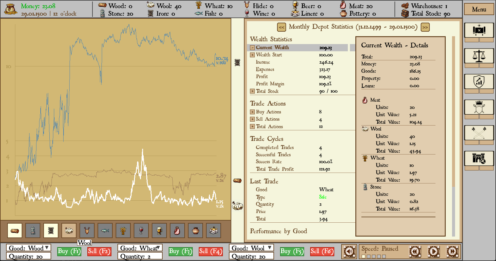
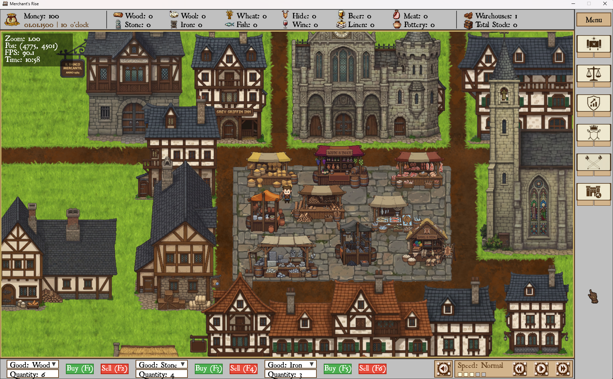
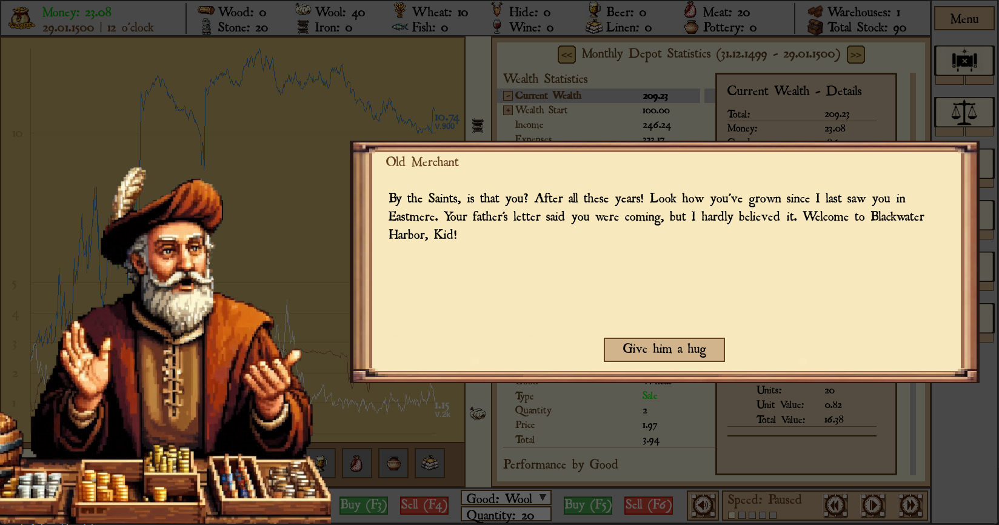
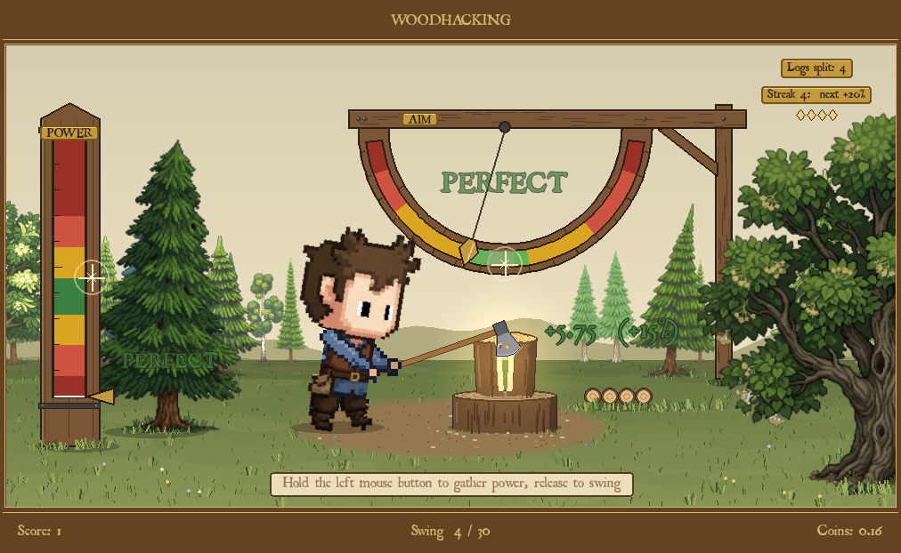
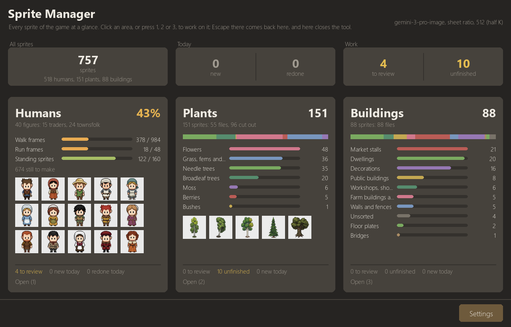
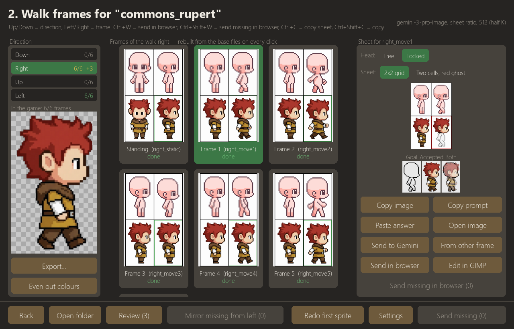
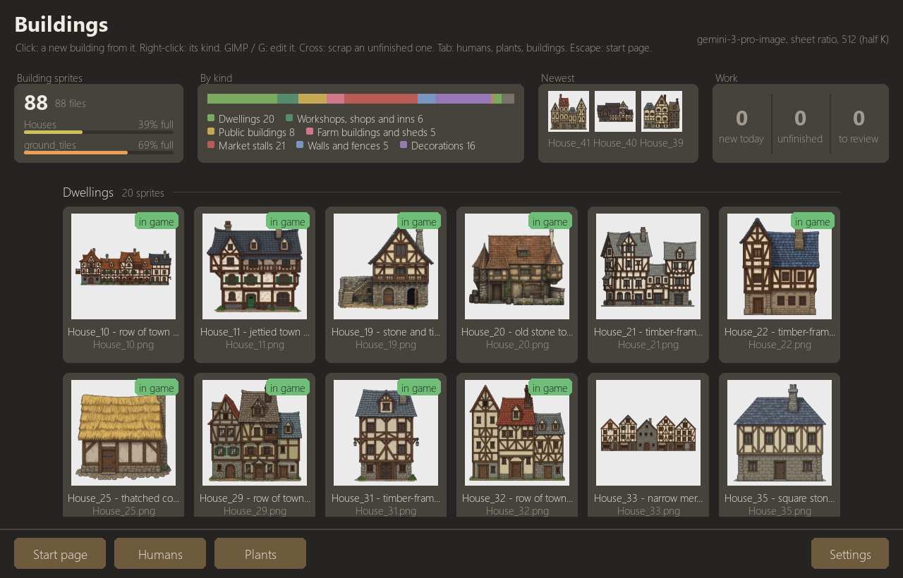
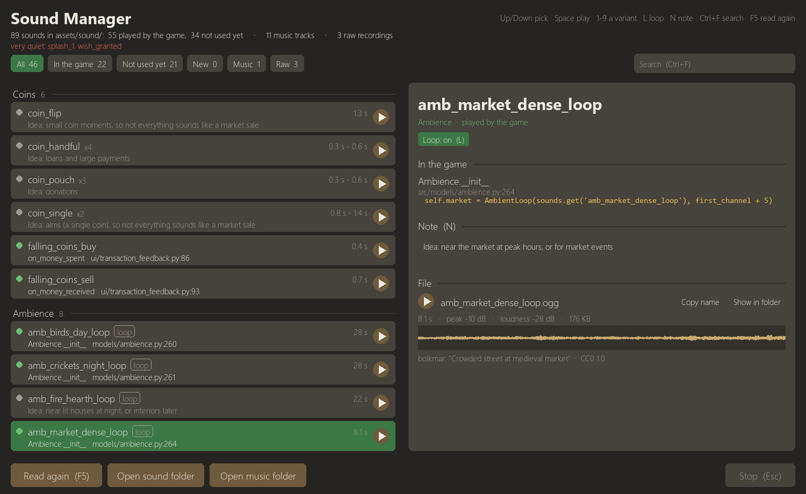

# Merchant's Rise

A hobby project for learning purposes:
**Merchant's Rise** is a medieval-themed trading and economic simulation game built with Python and Pygame.

## Overview

In **Merchant's Rise**, you take on the role of an aspiring trader in a living medieval town. Manage your depot, trade 30 goods in a market driven by the town's own needs and workshops, acquire trading licenses, and navigate a handcrafted pixel-art world through the seasons to grow your wealth — while keeping a close eye on the town's population and their happiness.

## Installation & Running

**Requirements:** Python 3.10+

1. Clone or download the repository.
2. (Recommended) Create and activate a virtual environment:
   ```bash
   python -m venv venv
   # Windows
   venv\Scripts\activate
   # macOS / Linux
   source venv/bin/activate
   ```
3. Install dependencies:
   ```bash
   pip install -r requirements.txt
   ```
4. Start the game:
   ```bash
   python main.py
   ```

Dependencies: `pygame==2.6.1` and `PyTMX==3.32`. There are no build steps.

**Tests** (headless, no window opens):

```bash
pip install -r requirements-dev.txt   # adds pytest
python -m pytest
python -m pytest -m "not slow"        # skip the tests that load the real map
```

`docs/testing.md` describes how each part of the code is tested.

**A Windows release** (an exe that needs nothing installed) is built with `py build_tools/Release/build_release.py <version>`; see `CLAUDE.md`.

## Key Features

- **Trading System** — Buy and sell 30 goods, from wheat, wood and fish to bread, tools, garments and spices. Each good has one price, set by supply and demand: how much the market holds against what the town needs. Every unit you buy or sell moves the price (slippage), each trade costs a fee, and profit is tracked FIFO against what you paid. Goods are stored in slots (each holds one good) in your starting storage, in warehouses you buy, and in the pack you carry; warehouses can be set to take only some goods.

  

- **A Living Economy** — The town feeds itself. Each social class buys a basket of needs in three tiers (basic, comfort, luxury) with the money it earns, buying less of a good the dearer it gets. The town's workshops turn raw goods into finished ones in real chains: wheat → flour → bread, livestock → meat, hides and tallow → leather, shoes and candles, wool and flax → cloth and linen → garments, iron and charcoal → tools that wear out. They hire townsfolk, run as hard as their margins allow, and grow or shrink with business. Merchants import what runs short and export gluts at the outside price, which drifts over the weeks. Your trades land in the same market: buy up the bread at ten in the morning and the poor go short at eleven.

- **Trade License System** — Each good is traded under a guild's license (Flour and Bread under Wheat, Tools under Iron, ...). Licenses are acquired via contracts at the town hall, cost a fee per season, and expire after the seasons bought — so managing your active licenses is part of the strategy.

- **Seasons & Calendar** — A year has four seasons of seven days, Spring to Winter, so a game can span generations. Dates read like "Wednesday, 3rd of Spring 1500". Demand and prices follow the seasons too: more firewood and candles in winter, and many goods' outside prices rise and fall with the time of year.

- **Weather & Light** — Rain from drizzle to downpour, mist and fog, and summer thunderstorms with lightning and thunder, following the seasons: more rain and fog in autumn, the storms only in summer. Rain splashes on roofs and ripples on water, puddles gather on the roads, and the ground darkens as it gets wet. Days are longer in summer and darker earlier in winter, and the light has a mood per season: warm in autumn, cold and bluish in winter.

- **Growing Crops** — The fields lie bare and ploughed through the winter, are sown on the 1st of Spring, grow through their stages and are harvested at the end of Autumn, each field a little ahead of or behind the next.

- **Depot Management** — Monitor your inventory, storage capacity, and historical wealth broken down into cash, goods value, property, and loans. Stacked bar charts show your stock composition over time.

- **Economic Visualization** — In-game charts for prices, wealth, money, stock, population, and happiness — all with hover tooltips showing the exact date, values, and breakdowns. Pin the goods you follow to the top bar.

- **Merchant Rank** — Rise from Peddler to Patrician on net wealth, property, trade volume and reputation, which you earn by giving to the church, the town and the poor. A rank you can no longer hold slips away after a grace period.

- **Save / Load System** — Numbered save slots (as many as you like) plus an autosave, with compressed, tamper-protected save files, thumbnails and playtime. All game state is persisted: the economy, map position, weather, explored land, and more.

- **Exploration Map** — A top-down tiled map (Tiled/TMX) with a zoomable, pannable camera. Walk your character through a medieval world complete with buildings, fields, forests, bridges and animated NPCs. A paper Town Map charts the land you have explored.

  

- **Population Simulation** — The town has four social classes (Poor, Commons, Middling Sort, Nobility). Each class's happiness follows how well its needs were met, and people move in or out with it, up to what the town's houses hold; overcrowding lowers happiness. Watch the trends in the depot's Population and Happiness charts.

- **Living Animations** — Sheep wander around the fields and bleat when you get close. Crops sway in the wind. The windmill's blades rotate continuously. Chimney smoke drifts from buildings at night. Townsfolk step out of their doors and walk the streets, fewer at night and in the rain, and traders mind their booths during their hours. A full day/night cycle shifts the lighting and atmosphere across the world.

  

- **Ambient Soundscape** — The world sounds like where you stand: birdsong in the woods by day and crickets out in the fields at night, owls in the woods and dogs in town, the river near its banks, waves along the open sea, the crowd at the market while its booths are open, the rain as hard as it falls, and the creaking gears of the mill. Each fades in and out with your distance to it; no sound areas are drawn by hand: they're worked out from the map itself (trees, buildings, water) when the game loads.

- **Dialogue System** — Engage with NPCs through a dialogue interface with portrait art, text boxes, and voice sounds.

  

- **Buildings & Institutions** — Church (with proximity bell sounds, donations and meals for the poor), Town Hall (population stats, licenses), Market, Bank (loans), Guildhall (merchant rank), the Grey Griffin Inn (a daily menu of period dishes), warehouses to buy, and the Mill, each with their own interactions and visual details including night lighting effects.

- **Minigames** — Early on, a day's work can earn you a little coin. At the woodcutter's you chop logs: hold the mouse button to gather power on the gauge post, and let go while the plumb bob swings over the sweet spot of the scale above the block. A clean blow splits the log, a fair one bites into it, a miss swishes past; splits in a row build a streak bonus, and a swing perfect on both gauges lands with a little extra weight. Once a day.

  

The screenshots above, all but the minigame's, were taken before the 30 goods, the new calendar and the weather; they still show the old top bar with 12 goods.

## Headless Simulation

The economy runs in its own package, `src/sim/`, which imports no pygame, so decades of it can be simulated in seconds for balancing:

```bash
python -m src.sim.run --years 20 --seed 1 --out runs/baseline   # a few seconds
python -m src.sim.health runs/baseline                          # check the run
```

The runner starts the town as a new game does and writes daily CSVs into the folder: `goods_daily.csv` (price, outside price, stock and target, demand, production, imports and exports per good), `population_daily.csv` (head count, jobs, wage, happiness, purse and need fulfilment per class), `workshops_daily.csv` (capacity, utilisation, margin, workers, cash) and `town_daily.csv` (the town's money and the merchants' books), plus `meta.json` (seed, settings, git commit). The same seed gives byte-identical files. The health report checks that the town's money balances and warns when the town is not running slightly short or a good's swings aren't worth trading. `docs/sim_core.md` has the details.

## Game Controls

| Input | Action |
|---|---|
| Arrow keys / WASD | Move character on the map |
| Mouse wheel | Zoom the map (Ctrl + wheel zooms out further) |
| Space | Toggle pause / normal speed |
| + / – | Zoom the map in and out; with the map not shown, faster / slower |
| 1 – 6 | Switch views: Explore, Market, Depot, Politics, Trade Routes, Town Map (M also opens the Town Map) |
| F1 – F6 | Hotkeys for buying and selling goods |
| I | What you carry |
| Q | Open quit confirmation |
| Right click on a good (market view) | Pin it to the top bar |
| Mouse | Interact with all UI elements |

The full list is under Settings → Controls in the game.

## Build Tools

`build_tools/` holds the standalone tools the game's content is made with. They are not part of the game and are not needed to play it. Run them from the repository root. The map tools write into `assets/tiles/Map1.tmx`, so **close Tiled first**, and try `--preview` before writing.

| Tool | What it does |
|---|---|
| **Sprite Manager** (`Sprite_Manager/Sprite_Manager.py`) | Makes and looks after every sprite of the game: the people's walk animations and the plants and buildings of the map, drawn with Google's Gemini image model. |
| **Sound Manager** (`Sound_Manager/Sound_Manager.py`) | Every sound of the game at a glance: which ones the game plays, where in the code, and which are not used yet. |
| **Forest Builder** (`Forest_Builder/grow_forest.py`) | Plants whole forests into the map, trees and forest floor, from a short description of each patch. |
| **Road Builder** (`Road_Builder/lay_road.py`) | Lays dirt roads, two tiles wide, joined to the roads already there. |
| **Field Plougher** (`Field_Plougher/plough_field.py`) | Bakes a ploughed field with furrows into the map's ground tiles. |

Extra dependencies for the tools (Gemini API, GIF and video export, colour evening) are in `build_tools/requirements.txt`:

```bash
pip install -r build_tools/requirements.txt
```

### Sprite Manager

```bash
python build_tools/Sprite_Manager/Sprite_Manager.py
```

The game's characters walk in four directions with six frames each, and the map holds hundreds of trees, plants and houses. Drawing all of that by hand is not feasible for a hobby project, so the Sprite Manager organises the work and leaves the drawing to an image model.

It opens on a **start page** with every sprite of the game at a glance: how many there are, how far each area is, what was made today and which answers are waiting for review. Click one of the three areas (or press 1, 2, 3) to work on it.



**People.** Add a townsperson (a gender and a medieval name, or a trade) and describe them; the tool asks Gemini for their first standing sprite. For each frame of a walk it then builds a reference sheet: the plain base figure in the pose, the person's own sprite, and a see-through "ghost" of the pose in the empty cell for the model to draw them into. The sheet goes to Gemini through the API, by copy and paste into its web page, or, with one key, through a small browser userscript that sends it, waits for the drawing and brings it back by itself (a chime says it is in). Every answer is kept for review; accepting one cuts the figure out, scales it like the person's other sprites and saves it under the name the game loads it by. Further helpers mirror frames from the other side, play the walk as it looks in the game, export it as a GIF or video, open a frame in GIMP, and even out the colours of a walk so it does not flicker.



**Plants and buildings.** All map sprites are sorted by kind (needle and broadleaf trees, flowers, dwellings, market stalls, bridges ...), and each card shows whether the map uses it yet. To make a new one, click a similar sprite as the example and sketch the new one's rough shape beside it in a few flat colours; the image model paints it from the sketch. An accepted sprite is saved, stamped into the sprite collection Tiled uses, and the tool prints the properties to give its object in Tiled.



Using the Gemini API needs a key with billing enabled, as image models are not in the free tier: put `GEMINI_API_KEY` in the environment or in a `.env` file. The copy-and-paste and browser ways work without one.

### Sound Manager

```bash
python build_tools/Sound_Manager/Sound_Manager.py
```

Lists every file in `assets/sound/` (and the music) with numbered variants grouped together (`knock_1` … `knock_5`), sorted by kind. It reads the game's source code to find where each sound is played, by name, built in an f-string (`f"knock_{n}"`) or picked by prefix, and shows the function and line; clicking it opens the code there in VS Code. Every file can be played and shows its waveform, length and loudness, so sounds far too quiet stand out. A note on what each sound is for, and the credits of sounds from Freesound, are kept in `sound_catalog.json`.



### Map tools

```bash
python build_tools/Forest_Builder/grow_forest.py --preview   # look first, the map stays untouched
python build_tools/Forest_Builder/grow_forest.py             # then plant
python build_tools/Road_Builder/lay_road.py --preview
python build_tools/Field_Plougher/plough_field.py
```

- **Forest Builder:** each forest patch is a few lines in the `PATCHES` list at the top of the script: its area, which trees grow there and how densely, clearings, a painted floor with grass and flowers. The script places every tree (in the game's object layer and as preview tiles for Tiled), keeps their trunks apart, and blends overlapping forest floor into new tiles so no seams show. `--remove` takes trees out again. Its [README](build_tools/Forest_Builder/README.md) has the details.
- **Road Builder:** roads are polylines in its `ROADS` list. It lays the dirt and the ragged grass edge along both sides, opens the junctions with the roads already there, stops at water and prints a bridge rectangle for each crossing.
- **Field Plougher:** bakes the furrowed dirt tiles of a ploughed field, shaped by the blocks at the top of the script, into `ground_tiles.png` and the map.

## Project Structure

```
main.py                  Entry point
src/
  sim/                   The headless economy: calendar, scheduler, market, households, workshops, runner
  models/                Core data: Player, Good, Depot, Map, weather, institutions
  ui/                    All UI components (charts, menus, dialogs, layout)
  handlers/              Keyboard and mouse input routing
  config/                Constants and colour definitions
  persistence/           Save / load system
assets/
  data/                  The economy's definitions: goods, needs, recipes, buildings, scenarios (JSON)
  tiles/                 Tiled tilesets and TMX map file
  map_sprites/           Building and NPC sprites
  pictures/              UI icons, portraits, and buttons
  sound/                 Sound effects and ambient loops
  music/                 Music tracks
build_tools/             Standalone tools for making sprites, sounds and the map (see Build Tools)
docs/                    Design documents and development roadmap
tests/                   Tests, mirroring src/ (pytest)
```
