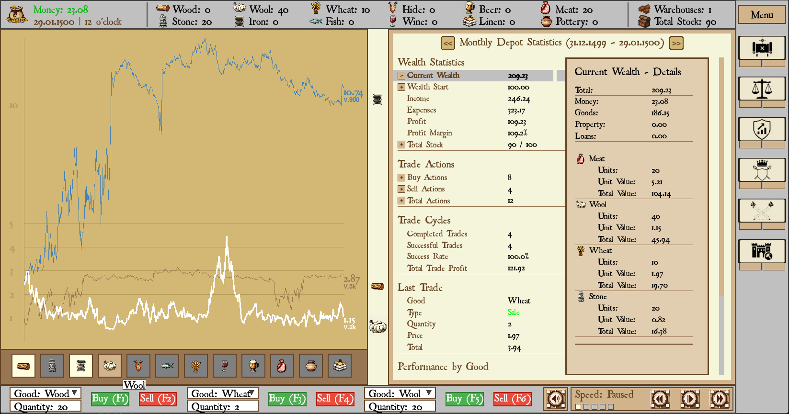
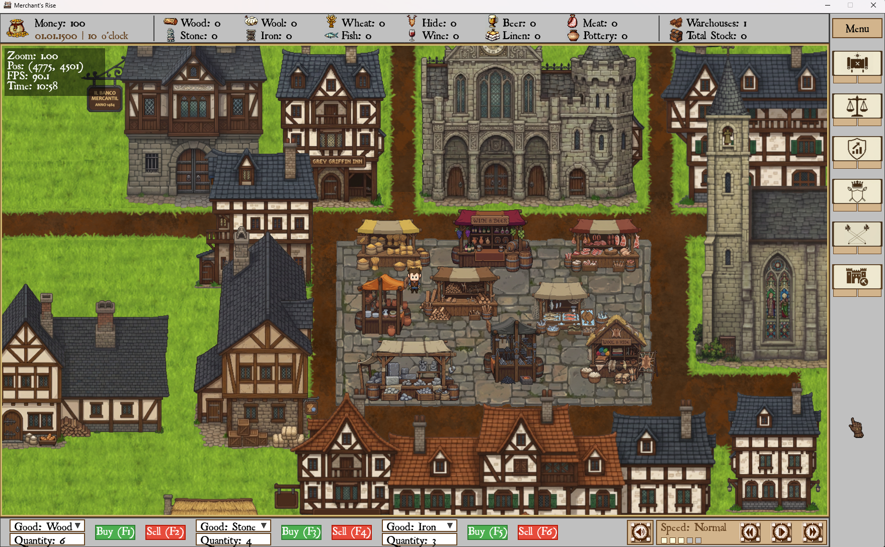
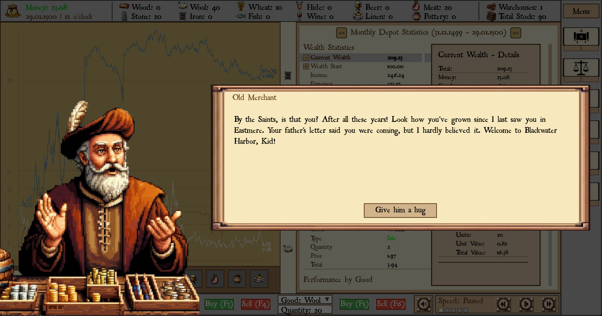
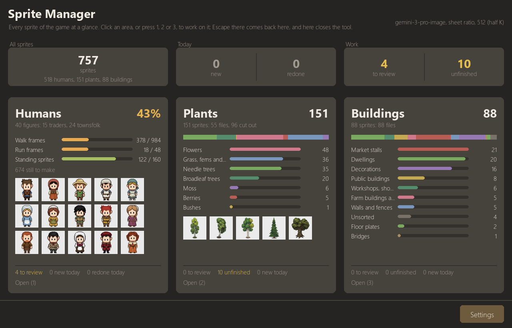
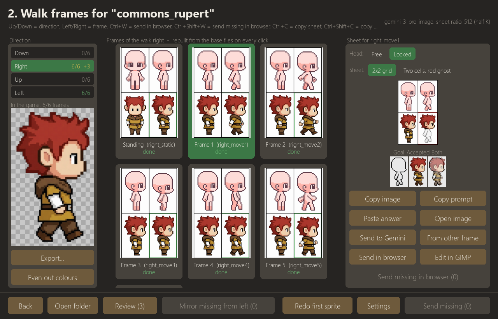
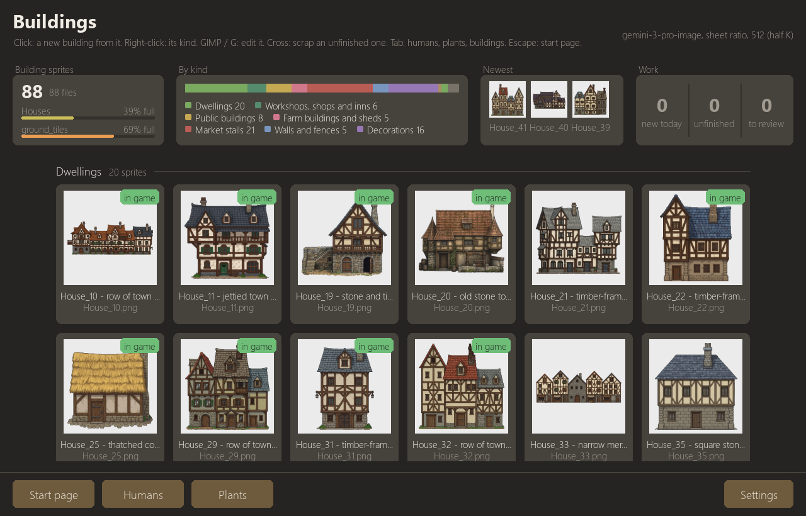
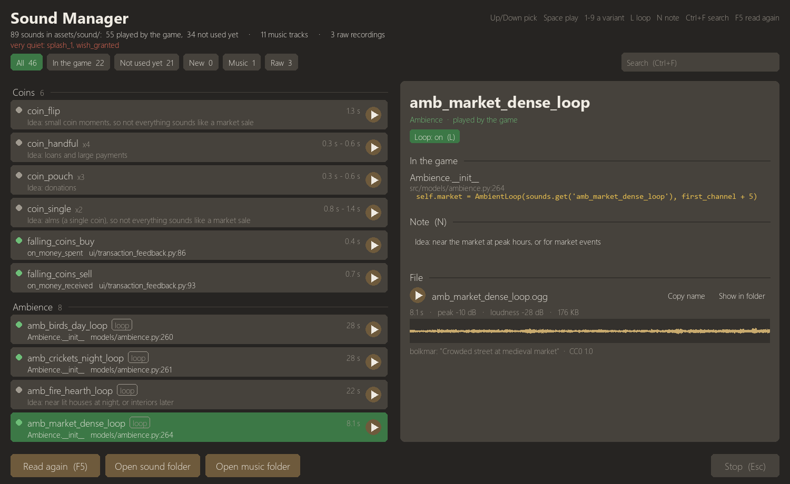

# Merchant's Rise

A hobby project for learning purposes:
**Merchant's Rise** is a medieval-themed trading and economic simulation game built with Python and Pygame.

## Overview

In **Merchant's Rise**, you take on the role of an aspiring trader in a living medieval town. Manage your depot, trade various goods, acquire trading licenses, and navigate a handcrafted pixel-art world to grow your wealth — while keeping a close eye on the town's population and their happiness.

## Installation & Running

**Requirements:** Python 3.10+

1. Clone or download the repository.
2. (Recommended) Create and activate a virtual environment:
   ```bash
   python -m venv venv
   # Windows
   venv\Scripts\activate
   # macOS / Linux
   source venv/bin/activate
   ```
3. Install dependencies:
   ```bash
   pip install -r requirements.txt
   ```
4. Start the game:
   ```bash
   python main.py
   ```

Dependencies: `pygame==2.6.1` and `PyTMX==3.32`. There are no build steps or tests.

## Key Features

- **Trading System** — Buy and sell 12 different commodities with dynamic market prices, transaction costs, and FIFO profit tracking.

  

- **Trade License System** — Each tradeable good requires a license to deal in. Licenses are acquired via contracts, cost a monthly fee, and expire after a set duration — so managing your portfolio of active contracts is part of the strategy.

- **Depot Management** — Monitor your inventory, storage capacity, and historical wealth broken down into cash, goods value, property, and loans. Stacked bar charts show your stock composition over time.

- **Economic Visualization** — In-game charts for wealth, money, stock, population, and happiness — all with hover tooltips showing the exact date, values, and breakdowns.

- **Save / Load System** — Three save slots with compressed, tamper-protected save files. All game state is persisted: economy, map position, population histories, and more.

- **Exploration Map** — A top-down tiled map (Tiled/TMX) with a zoomable, pannable camera. Walk your character through a medieval world complete with buildings, fields, trees, and animated NPCs.

  

- **Population Simulation** — The town has four social classes (Poor, Commons, Middling Sort, Nobility) whose population and happiness evolve daily. Overcrowding reduces happiness; a half-empty town gives a bonus. Watch the trends in the depot's Population and Happiness charts.

- **Living Animations** — Sheep wander around the fields and bleat when you get close. Wheat fields sway in the wind. The windmill's blades rotate continuously. Chimney smoke drifts from buildings at night. A full day/night cycle shifts the lighting and atmosphere across the world.

  

- **Ambient Soundscape** — The world sounds like where you stand: birdsong in the woods by day and crickets out in the fields at night, the river near its banks, waves along the open sea, the crowd at the market while its booths are open, and the creaking gears of the mill. Each fades in and out with your distance to it; no sound areas are drawn by hand: they're worked out from the map itself (trees, buildings, water) when the game loads.

- **Dialogue System** — Engage with NPCs through a dialogue interface with portrait art, text boxes, and voice sounds.

  

- **Buildings & Institutions** — Church (with proximity bell sounds), Town Hall (population stats), Market, Bank, and Mill, each with their own interactions and visual details including night lighting effects.

## Game Controls

| Input | Action |
|---|---|
| Arrow keys / WASD | Move character on the map |
| Space | Toggle pause / normal speed |
| F1 – F6 | Hotkeys for buying and selling goods |
| Q | Open quit confirmation |
| Mouse | Interact with all UI elements |

## Build Tools

`build_tools/` holds the standalone tools the game's content is made with. They are not part of the game and are not needed to play it. Run them from the repository root. The map tools write into `assets/tiles/Map1.tmx`, so **close Tiled first**, and try `--preview` before writing.

| Tool | What it does |
|---|---|
| **Sprite Manager** (`Sprite_Manager/Sprite_Manager.py`) | Makes and looks after every sprite of the game: the people's walk animations and the plants and buildings of the map, drawn with Google's Gemini image model. |
| **Sound Manager** (`Sound_Manager/Sound_Manager.py`) | Every sound of the game at a glance: which ones the game plays, where in the code, and which are not used yet. |
| **Forest Builder** (`Forest_Builder/grow_forest.py`) | Plants whole forests into the map, trees and forest floor, from a short description of each patch. |
| **Road Builder** (`Road_Builder/lay_road.py`) | Lays dirt roads, two tiles wide, joined to the roads already there. |
| **Field Plougher** (`Field_Plougher/plough_field.py`) | Bakes a ploughed field with furrows into the map's ground tiles. |

Extra dependencies for the tools (Gemini API, GIF and video export, colour evening) are in `build_tools/requirements.txt`:

```bash
pip install -r build_tools/requirements.txt
```

### Sprite Manager

```bash
python build_tools/Sprite_Manager/Sprite_Manager.py
```

The game's characters walk in four directions with six frames each, and the map holds hundreds of trees, plants and houses. Drawing all of that by hand is not feasible for a hobby project, so the Sprite Manager organises the work and leaves the drawing to an image model.

It opens on a **start page** with every sprite of the game at a glance: how many there are, how far each area is, what was made today and which answers are waiting for review. Click one of the three areas (or press 1, 2, 3) to work on it.



**People.** Add a townsperson (a gender and a medieval name, or a trade) and describe them; the tool asks Gemini for their first standing sprite. For each frame of a walk it then builds a reference sheet: the plain base figure in the pose, the person's own sprite, and a see-through "ghost" of the pose in the empty cell for the model to draw them into. The sheet goes to Gemini through the API, by copy and paste into its web page, or, with one key, through a small browser userscript that sends it, waits for the drawing and brings it back by itself (a chime says it is in). Every answer is kept for review; accepting one cuts the figure out, scales it like the person's other sprites and saves it under the name the game loads it by. Further helpers mirror frames from the other side, play the walk as it looks in the game, export it as a GIF or video, open a frame in GIMP, and even out the colours of a walk so it does not flicker.



**Plants and buildings.** All map sprites are sorted by kind (needle and broadleaf trees, flowers, dwellings, market stalls, bridges ...), and each card shows whether the map uses it yet. To make a new one, click a similar sprite as the example and sketch the new one's rough shape beside it in a few flat colours; the image model paints it from the sketch. An accepted sprite is saved, stamped into the sprite collection Tiled uses, and the tool prints the properties to give its object in Tiled.



Using the Gemini API needs a key with billing enabled, as image models are not in the free tier: put `GEMINI_API_KEY` in the environment or in a `.env` file. The copy-and-paste and browser ways work without one.

### Sound Manager

```bash
python build_tools/Sound_Manager/Sound_Manager.py
```

Lists every file in `assets/sound/` (and the music) with numbered variants grouped together (`knock_1` … `knock_5`), sorted by kind. It reads the game's source code to find where each sound is played, by name, built in an f-string (`f"knock_{n}"`) or picked by prefix, and shows the function and line; clicking it opens the code there in VS Code. Every file can be played and shows its waveform, length and loudness, so sounds far too quiet stand out. A note on what each sound is for, and the credits of sounds from Freesound, are kept in `sound_catalog.json`.



### Map tools

```bash
python build_tools/Forest_Builder/grow_forest.py --preview   # look first, the map stays untouched
python build_tools/Forest_Builder/grow_forest.py             # then plant
python build_tools/Road_Builder/lay_road.py --preview
python build_tools/Field_Plougher/plough_field.py
```

- **Forest Builder:** each forest patch is a few lines in the `PATCHES` list at the top of the script: its area, which trees grow there and how densely, clearings, a painted floor with grass and flowers. The script places every tree (in the game's object layer and as preview tiles for Tiled), keeps their trunks apart, and blends overlapping forest floor into new tiles so no seams show. `--remove` takes trees out again. Its [README](build_tools/Forest_Builder/README.md) has the details.
- **Road Builder:** roads are polylines in its `ROADS` list. It lays the dirt and the ragged grass edge along both sides, opens the junctions with the roads already there, stops at water and prints a bridge rectangle for each crossing.
- **Field Plougher:** bakes the furrowed dirt tiles of a ploughed field, shaped by the blocks at the top of the script, into `ground_tiles.png` and the map.

## Project Structure

```
main.py                  Entry point
src/
  models/                Core data: Player, Good, Depot, Map, institutions
  ui/                    All UI components (charts, menus, dialogs, layout)
  handlers/              Keyboard and mouse input routing
  config/                Constants and colour definitions
  persistence/           Save / load system
assets/
  tiles/                 Tiled tilesets and TMX map file
  map_sprites/           Building and NPC sprites
  pictures/              UI icons, portraits, and buttons
  sound/                 Sound effects and ambient loops
  music/                 Music tracks
build_tools/             Standalone tools for making sprites, sounds and the map (see Build Tools)
docs/                    Design documents and development roadmap
```
